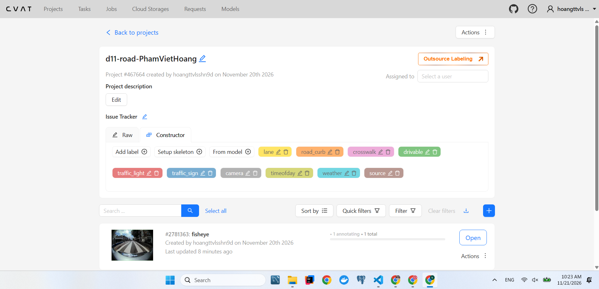
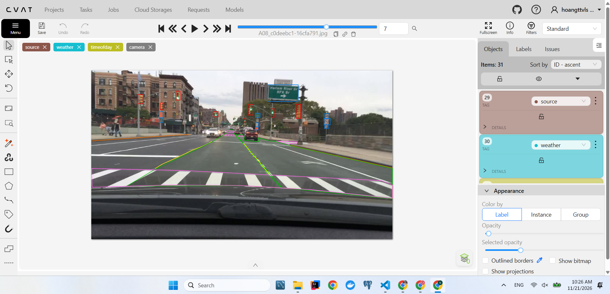
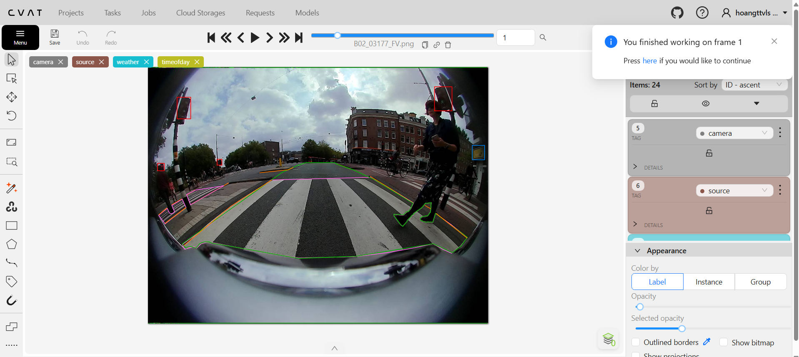
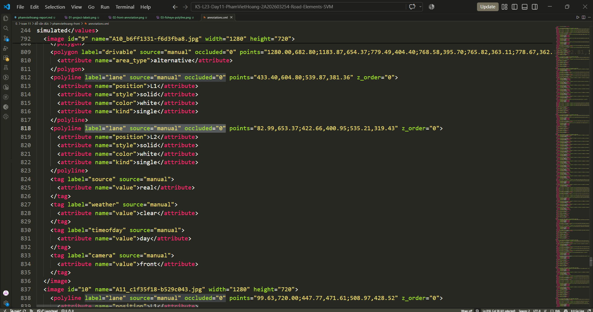

# Báo cáo cá nhân — Ngày 11

**Họ tên:** Phạm Việt Hoàng  
**Mã học viên:** 2A202603254  
**Phiên bản CVAT (Help → About):** v2.82.0  
**Guideline:** Road v1.0  
**Lần nộp (revision trong manifest):** 1  
**Thời điểm export:** 10:10
**Số lần nộp lại sau Rework:** 0

## 1. Kiểm project

| Mục | Đúng như guideline Road v1.0? | Ghi chú |
|---|---|---|
| 6 label, đúng kiểu | Đúng cấu hình | lane, road_curb: Polyline; crosswalk, drivable: Polygon; traffic_light, traffic_sign: Rectangle |
| Thuộc tính và giá trị | Đã cấu hình theo taxonomy | lane: position, style, color, kind; drivable: area_type; traffic_light: color, type, facing, edge_zone; traffic_sign: group, facing, edge_zone |
| 4 tag ảnh | Đạt kiểm tra cấu trúc | 20/20 ảnh có đủ camera, timeofday, weather, source; không còn cảnh báo QC1-01 |

**Cách kết thúc polyline trên bản CVAT này:** Sử dụng công cụ Polyline, đặt lần lượt các điểm dọc theo đối tượng, hoàn tất thao tác vẽ và lưu annotation. Đối với lane, cần tuân thủ thứ tự điểm từ gần xe ra xa.

**Cách đặt tag ảnh trên bản CVAT này:** Sử dụng công cụ Tag, thêm camera, timeofday, weather, source và lựa chọn thuộc tính value tương ứng với từng ảnh.

## 2. Số lượng đã gán

| Task | Ảnh | lane | road_curb | crosswalk | drivable | traffic_light | traffic_sign |
|---|---:|---:|---:|---:|---:|---:|---:|
| front | 12 | 27 | 15 | 14 | 33 | 23 | 14 |
| front-extra (0/4) | 0 | 0 | 0 | 0 | 0 | 0 | 0 |
| fisheye | 8 | 13 | 26 | 13 | 10 | 7 | 6 |
| fisheye-extra (0/4) | 0 | 0 | 0 | 0 | 0 | 0 | 0 |
| **Tổng** | **20** | **40** | **41** | **27** | **43** | **30** | **20** |

**Tổng số shape:** 201.

**Thống kê dữ liệu:**

- Front: 12 ảnh, 126 shape.
- Fisheye: 8 ảnh, 75 shape.
- Tổng cộng: 20 ảnh, 201 shape.
- 20/20 ảnh có đầy đủ bốn loại Tag.
- Không có ảnh chưa được gán nhãn.
- Hai file export không chứa ảnh gốc.

## 3. Bảng ca khó

| Ảnh | Nhãn | Phân vân giữa | Đã chọn / hướng xử lý | Lý do |
|---|---|---|---|---|
| A05 | lane | Có L1/R1 hoặc không có vạch làn | Cần xác nhận trên ảnh | Không có lane trong file export; lint báo thiếu L1 và R1 |
| A06 | lane | Xác định R1 và chiều điểm của polyline | Cần rà soát | Lint báo thiếu R1 và cảnh báo thứ tự điểm của lane#10 |
| A07 | lane | Có vạch L1 nhìn thấy hay không |đối chiếu ảnh | Lint báo thiếu L1 |
| A09–A10 | lane | Có R1 nhìn thấy hay không |đối chiếu ảnh | Lint báo thiếu R1 |
| B01–B02 | camera | front / fisheye_front | fisheye_front | Đã điều chỉnh thuộc tính camera; kết quả lint mới không còn QC1-01 |
| B02 | road_curb | Đường thẳng hay đường cong do fisheye | theo hình dạng thực tế | Nhiều polyline có 2–3 điểm |
| B02 | traffic_light, traffic_sign | edge_zone bật hay tắt |đối chiếu vị trí tâm Rectangle | Có 4 cảnh báo đối tượng nằm gần rìa ảnh |
| B03 | road_curb, traffic_sign | Hình dạng đường cong và edge_zone | Cần rà soát | Có cảnh báo về số điểm Polyline và vị trí biển báo |
| B05 | road_curb | Số điểm phù hợp để thể hiện đường cong | đối chiếu ảnh | Bốn polyline có ít điểm |

**Nhận xét:**

Các trường hợp cần chú ý chủ yếu liên quan đến xác định vạch làn trong ảnh Front và xử lý hình dạng Polyline ở Fisheye.

Với những ảnh không xuất hiện rõ L1/R1, cần kiểm tra trực quan trước khi bổ sung annotation. Không vẽ thêm vạch chỉ nhằm loại cảnh báo tự động.

Đối với ảnh Fisheye, số điểm trên Polyline cần phù hợp với hình dạng thực tế. Nếu đường mép cong, cần sử dụng đủ điểm để bám theo đường cong. Nếu đoạn mép thẳng, số điểm ít không nhất thiết là lỗi.

Các đối tượng nằm sát rìa ảnh cần được kiểm tra thuộc tính edge_zone theo ngưỡng quy định.

## 4. Phiếu QC 1 nhận được

**Bạn kiểm lô của tôi:** Nguyễn Văn Hùng - 2A202603295   
**Quyết định nhận được:** Release

| Mã lỗi | Số lỗi | Đồng ý? | Đã sửa? |
|---|---:|---|---|
| 01 | 1 | không | chưa |

**Ghi chú:** Đã sử dụng road_check lint để rà soát dữ liệu trước khi nộp. Kết quả công cụ là cảnh báo tự động, không thay thế phiếu kiểm tra của học viên được phân công QC.

## 5. Kiểm file export

| File | Mở lại được? | Số shape ảnh 1 (job / file) | Số shape ảnh 2 (job / file) | Tag camera có trong XML? |
|---|---|---|---|---|
| phamviethoang-front.zip | có | 11| 9| Có |
| phamviethoang-fisheye.zip |có |6 |20 | Có |

### Thông tin file Front

- Tên file: phamviethoang-front.zip
- Dung lượng: 50.175 bytes.
- Số ảnh: 12.
- Tổng shape: 126.
- Ảnh chưa gán nhãn: 0.
- Ảnh có đủ Tag: 12/12.
- contains_images: false.
- SHA256: `fd5fc4ffc3381f26280e789f33ea625e718f19577676b43086b1a23382ec79c3`

### Thông tin file Fisheye

- Tên file: phamviethoang-fisheye.zip
- Dung lượng: 37.281 bytes.
- Số ảnh: 8.
- Tổng shape: 75.
- Ảnh chưa gán nhãn: 0.
- Ảnh có đủ Tag: 8/8.
- contains_images: false.
- SHA256: `470df6b6932ac094b45204f18864afaa48446bf3169dc7a1404a8365e6e78748`

### Kết quả kiểm tra lint

| Mức cảnh báo | Số lượng |
|---|---:|
| Nặng | 6 |
| Chính | 22 |
| Nhẹ | 3 |
| **Tổng** | **31** |

**Kết quả rà soát:**

- Đã xử lý cảnh báo sai Tag camera tại B01 và B02.
- Không còn cảnh báo QC1-01 về sai loại camera.
- Sáu cảnh báo nặng còn lại thuộc QC1-02, liên quan đến L1/R1.
- Các cảnh báo chính tập trung vào thứ tự điểm Polyline, số điểm road_curb và edge_zone.
- Các cảnh báo nhẹ gồm điểm lặp trên annotation và một đèn giao thông có chiều cao hộp nhỏ hơn 8 pixel.

**Chi tiết các trường hợp cần kiểm tra:**

| Mã QC | Ảnh | Vấn đề |
|---|---|---|
| QC1-02 | A05 | Thiếu L1, R1 theo điều kiện lint |
| QC1-02 | A06 | Thiếu R1 theo điều kiện lint |
| QC1-02 | A07 | Thiếu L1 theo điều kiện lint |
| QC1-02 | A09 | Thiếu R1 theo điều kiện lint |
| QC1-02 | A10 | Thiếu R1 theo điều kiện lint |
| QC1-04 | A06 | Thứ tự điểm Polyline cần xác nhận |
| QC1-11 | B02, B03, B05 | Polyline có ít điểm hoặc edge_zone cần kiểm tra |
| QC1-12 | A01, B06 | Điểm lặp liên tiếp |
| QC1-08 | A03 | Rectangle đèn có chiều cao dưới 8 pixel |

**Nhận xét về kết quả kiểm tra:**

Dữ liệu export đáp ứng các kiểm tra về số lượng ảnh, sự hiện diện của nhãn và Tag. Hai ZIP không chứa ảnh gốc.

Tuy nhiên, vẫn có 31 cảnh báo tự động cần được phân loại bằng kiểm tra trực quan hoặc kết quả QC. Không thể kết luận toàn bộ 31 cảnh báo đều là lỗi annotation.
## 6. Ảnh chụp màn hình

### Ảnh 1 — Cấu hình project

### Ảnh 2 — Annotation Front

### Ảnh 3 — Annotation Fisheye

### Ảnh 4 — Dữ liệu XML

## 7. Tự đánh giá

**Lỗi cần chú ý nhất hôm nay:**

Qua quá trình kiểm tra, các mã cần tập trung rà soát là QC1-02, QC1-04 và QC1-11.

QC1-02 liên quan đến việc xác định đầy đủ các vạch L1/R1. Một số ảnh không có vạch tương ứng trong dữ liệu export. Trước khi kết luận là lỗi bỏ sót, cần kiểm tra xem các vạch đó có thực sự xuất hiện trong ảnh hay không.

QC1-04 liên quan đến chất lượng đường Polyline, đặc biệt là thứ tự các điểm từ gần xe ra xa.

QC1-11 liên quan đến quy tắc riêng của Fisheye, bao gồm độ cong của Polyline và thuộc tính edge_zone đối với biển báo, đèn giao thông ở rìa ảnh.

Ngoài ra, hai cảnh báo QC1-01 ở B01 và B02 đã được xử lý bằng cách sửa giá trị camera thành fisheye_front.

**Cách tránh lỗi ở Ngày 20:**

Trước khi hoàn thành mỗi ảnh, cần thực hiện quy trình kiểm tra:

1. Xác nhận chính xác loại camera và bốn Tag.
2. Kiểm tra các lane L1, R1, L2, R2.
3. Xác nhận thuộc tính position, style, color và kind.
4. Kiểm tra độ chính xác của Polyline, thứ tự điểm và tính liên tục.
5. Kiểm tra ranh giới Polygon drivable.
6. Rà soát thuộc tính của traffic_light và traffic_sign.
7. Kiểm tra edge_zone với ảnh Fisheye.
8. Export dữ liệu, chạy lint và xác minh trực quan các cảnh báo trước khi nộp.

**Nhãn của tôi đi vào model ở đâu?**

Các polyline lane có thể được chuyển đổi thành tọa độ tại từng hàng ảnh để tạo nhãn huấn luyện cho mô hình phát hiện làn đường.

Khi Polyline bị lệch khỏi tâm vạch sơn, dữ liệu huấn luyện sẽ thể hiện vị trí làn không chính xác. Nếu Polyline kết thúc quá sớm, một số hàng ảnh sẽ thiếu tọa độ nhãn dù vạch thực tế vẫn xuất hiện.

Những sai lệch này có thể khiến mô hình học sai vị trí làn đường, ảnh hưởng đến hệ thống Lane Keeping Assist (LKA).

Tương tự, Polygon drivable vẽ tràn sang lề đường hoặc khu vực không thể đi có thể khiến mô hình nhận diện nhầm vùng không an toàn thành mặt đường có thể di chuyển.

Vì vậy, chất lượng annotation ảnh hưởng trực tiếp đến chất lượng dữ liệu mục tiêu và khả năng tổng quát hóa của mô hình.

## 8. (Tùy chọn, buffer) Từ polyline đến đích row-anchor
